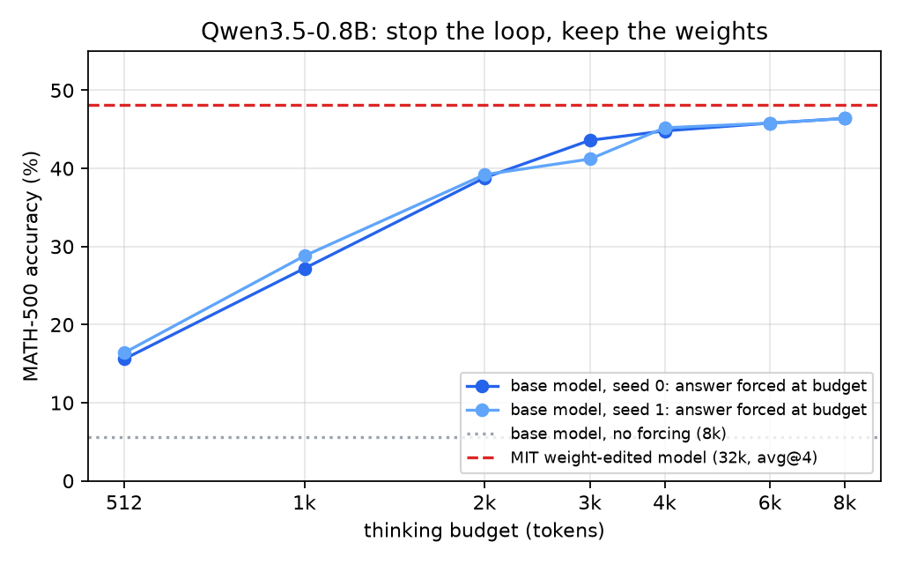

# It's the loop, not the weights

**Read the article: [paper.md](paper.md)**

MIT's *Weight-Space Programming* (Nov 2026) edits the weights of Qwen3.5-0.8B and lifts MATH-500 from 7.9% to 48.1%. In their own numbers, truncated outputs drop from 93% to 33% at the same time. We checked how much of that gain you get without touching the weights: let the unmodified model think, stop it at a token budget, and make it write its answer.



| Qwen3.5-0.8B on full MATH-500 | tokens | accuracy |
|---|---|---|
| unmodified, no forcing | 8k | 5.6% (94% truncated) |
| unmodified, answer forced at budget | 4k | 45.0% (mean of 2 seeds) |
| unmodified, answer forced at budget | 8k | **46.4%** (both seeds) |
| MIT weight-edited model | 32k | 48.1% (avg@4) |

Written instructions ("reason tersely", "stop once your answer checks out") and nudges inserted into the reasoning do not stop the model from looping at this size. Forcing the answer is the only thing that works. Details, limitations and references are in the [article](paper.md).

## Repository

| path | contents |
|---|---|
| `paper.md` | the article |
| `src/promptvariants.py` | generation with prompt variants and in-reasoning nudges (vLLM) |
| `src/ckptprobe.py` | forced-answer probe every 512 tokens of each trace |
| `src/loopdiag.py` | shared helpers: answer extraction, loop detector, sampling |
| `src/loopsurvey.py`, `src/stop_rules.py` | multi-model survey and offline stopping rules (not used in the article) |
| `analysis/results.py` | re-grades every trace and regenerates all numbers and the figure |
| `analysis/results.md` | output of `results.py` |
| `data/` | all generated traces and probe answers (gzipped JSONL) |
| `tools/gpu_job.sh` | runs one experiment on a throwaway GCP L4 VM and saves results to GCS |

## Reproduce

Numbers and figure from the released traces (CPU, ~30 min):

```bash
pip install "math-verify[antlr4_13_2]==0.9.0" pandas matplotlib tabulate
python analysis/results.py
```

New traces (one GPU with 24 GB, ~45 min for 500 problems at 8k):

```bash
pip install "vllm==0.33.0" "math-verify[antlr4_13_2]==0.9.0" datasets pandas
cd src
python promptvariants.py --variants base --n-step 1 --out results
python ckptprobe.py --model qwen3.5-0.8b --out results --glob gen_base.jsonl --max-tokens 8192
```

## Citation

```
@misc{dewinter2026loop,
  title  = {It's the loop, not the weights: stopping a looping 0.8B reasoning model recovers almost all of a weight-editing gain on MATH-500},
  author = {de Winter, Jasper},
  year   = {2026},
  url    = {https://github.com/jasperdew/its-the-loop}
}
```

MIT License.
