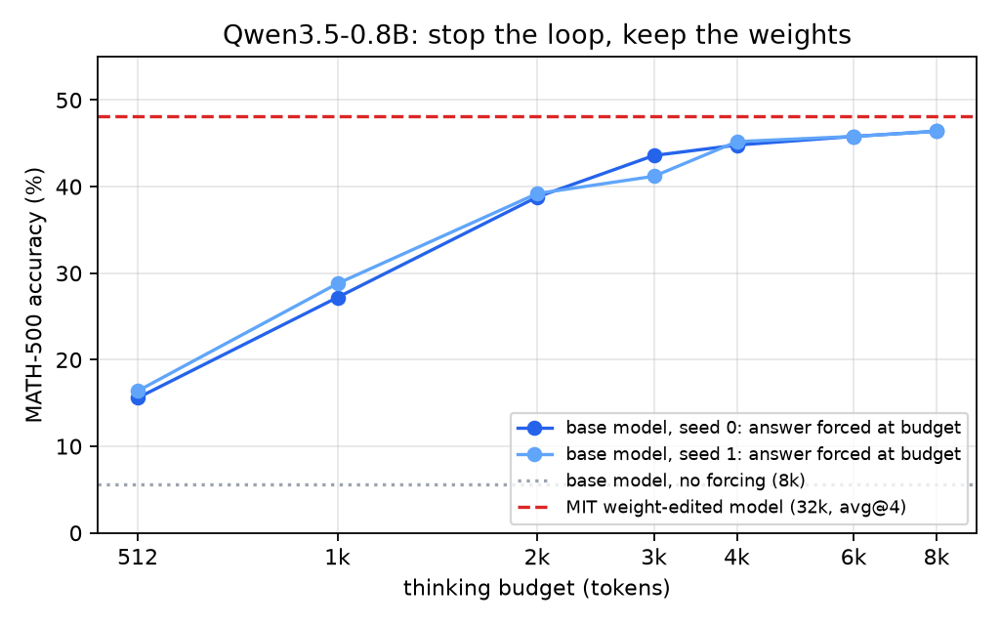

# It's the loop, not the weights

**Stopping a looping 0.8B reasoning model recovers almost all of a weight-editing gain on MATH-500**

Jasper de Winter · November 2026 · code and data: this repository

## Abstract

A recent MIT report, *Weight-Space Programming* (Takehi et al., 2026), edits the weights of Qwen3.5-0.8B and raises its MATH-500 accuracy from 7.9% to 48.1%. In the same report, the share of truncated outputs drops from 93% to 33%. That made us suspect that most of the gain comes from the model no longer getting stuck in its own reasoning, not from new mathematical ability. We test this without touching the weights. We let the unmodified model think, cut it off at a fixed token budget, and force it to write its final answer. On the full MATH-500 set, with the same sampling settings as the MIT evaluation, this lifts accuracy from 5.6% to 46.4% at an 8k-token budget (two seeds, both 46.4%) and to 45.0% at 4k. The edited model reaches 48.1% with a 32k budget. We also tried text-only fixes: instructions to reason tersely, written stopping rules, and short nudges inserted into the reasoning when the model loops or finds an answer. None of them changes how often the model finishes on its own. Forcing the answer is the only intervention that works.

## 1. Why we looked

Small reasoning models are known to loop: they repeat the same lines of reasoning until they run out of tokens. The Qwen3.5 model card itself warns that the smallest sizes are more prone to this. When an output is truncated mid-thought there is no final answer to grade, so it counts as wrong even if the model had found the right answer thousands of tokens earlier.

The MIT report gives two numbers side by side: accuracy goes from 7.9% to 48.1%, and truncation goes from 93% to 33%. If most of the recovered problems are ones that used to be cut off, then a much simpler intervention than weight editing should get most of the way there. Budget forcing (Muennighoff et al., 2025, "s1") is exactly that kind of intervention: stop the reasoning at a budget and append a short string that makes the model answer.

## 2. Setup

- **Model:** Qwen/Qwen3.5-0.8B, thinking mode on, unmodified weights.
- **Data:** all 500 MATH-500 problems. Prompt: the problem plus "Please reason step by step, and put your final answer within \boxed{}."
- **Sampling:** the MIT evaluation settings: temperature 0.6, top_p 0.95, top_k 20, presence_penalty 1.5. vLLM 0.33.0, max 8,192 generated tokens.
- **Grading:** math-verify on the last `\boxed{}` of the final answer.
- **Forced answer:** at checkpoint *t* (every 512 tokens, plus the trace's own end), we take the first *t* reasoning tokens and append `</think>` followed by `The final answer is $\boxed{`. The model then completes the answer greedily (max 48 tokens). Because every checkpoint is a prefix of one trace, one generation gives the whole accuracy-versus-budget curve. Accuracy at budget *b* uses the last checkpoint at or before *b*.
- **Loop detector** (for the nudge experiments only): fewer than 50% distinct 20-grams in a 512-token window.
- **Compute:** one NVIDIA L4. All experiments in this note cost about 6 euros of cloud time.

## 3. Results

### 3.1 Forcing the answer recovers almost all of the gain



| full MATH-500, forced at budget | 512 | 1k | 2k | 3k | 4k | 6k | 8k | no forcing (8k) |
|---|---|---|---|---|---|---|---|---|
| seed 0 | 15.6 | 27.2 | 38.8 | 43.6 | 44.8 | 45.8 | **46.4** | 5.6 |
| seed 1 | 16.4 | 28.8 | 39.2 | 41.2 | 45.2 | 45.8 | **46.4** | 5.8 |
| MIT edited weights (32k, avg@4) | | | | | | | | **48.1** |

Left alone, the model truncates 94.4% of its outputs at 8k tokens. Forced to answer, it gets 46.4% at 8k and 45% at 4k: within 1.7 and 3.1 points of the edited model, which used four times and eight times as many tokens. Half of the final accuracy is already there at 1k tokens.

If an oracle could pick the best checkpoint for every problem, accuracy would be 49.2% (seed 0) and 50.8% (seed 1). So within an 8k budget, the remaining headroom from smarter stopping is small, about 3 to 4 points.

### 3.2 Text-only fixes do not work at this size

We tested ten variants on a fixed 100-problem subset (every fifth problem), all with the same sampling.

| variant | text | natural accuracy | forced at 8k |
|---|---|---|---|
| base | (none) | 4 | 44 |
| terse1 | "Think in terse notes: equations, no prose, never restate." | 4 | 49 |
| terse2 | "Reason tersely. Short steps. No repetition." | 7 | 46 |
| stop1 | "Verify once, then stop." | 2 | 46 |
| stop2 | "Stop thinking once your answer checks out." | 3 | 47 |
| terse_stop1 | "Think in terse notes. Verify once, then stop." | 4 | 46 |
| terse_stop2 | "Reason tersely. Stop once your answer checks out." | 5 | 50 |
| inject_loop | on a detected loop, insert "I'm going in circles. Commit to my best answer." | 5 | 48 |
| inject_answer | on each new candidate answer X, insert "(Answer: X. Stop unless I find an error.)" | 7 | 52 |
| inject_period | every 1,024 tokens, insert "(Check: do I have the answer? If yes, stop.)" | 9 | 46 |

Every variant still truncates 91 to 98% of its outputs. The 0.8B model does not act on written instructions to stop, whether they come before the problem or inside its own reasoning. The forced-answer column moves by a few points, but on 100 problems that is within noise. We checked the most promising one, terse1, on all 500 problems: 45.0% at 8k against 46.4% for the plain prompt.

Majority voting over the forced answers at all checkpoints did not help either (45.4% for one seed, 44.4% pooled over two seeds, against 46.4% for the last checkpoint).

## 4. What this means

For this model and benchmark, most of the reported weight-editing gain can be reproduced by a two-line change to the decoding loop. The edited model may well have learned something real. But the headline comparison, 7.9% against 48.1%, mostly measures how often the base model fails to finish, not how much mathematics it knows. Any intervention on small reasoning models should be compared against a budget-forced baseline, not against the raw truncated one.

## 5. Limitations

- **Protocol mismatch.** We use an 8k budget and one sample per problem per seed (two seeds); MIT uses 32k and averages four samples. Our unforced baseline is 5.6% at 8k against their 7.9% at 32k. A 16k run was started but lost when the budget limit stopped the machine before the results were saved.
- **One model, one benchmark.** We have not tested other small models or AIME.
- **Known technique.** Budget forcing is not new (Muennighoff et al., 2025). The contribution here is the comparison, not the method.
- **No peer review**, on our side or on the MIT side.

## 6. Reproduce

Every number in this note comes from the traces in `data/`. `python analysis/results.py` re-grades them and redraws the figure. To regenerate the traces on one GPU:

```bash
cd src
python promptvariants.py --variants base --n-step 1 --out results
python ckptprobe.py --model qwen3.5-0.8b --out results --glob gen_base.jsonl --max-tokens 8192
```

## References

- Takehi et al. *Weight-Space Programming.* MIT, blog post, 2 November 2026. Logs: github.com/RikiyaT/lm_understand-logs. Edited model: RikiyaT/Qwen3.5-0.8B-weight-space-programming.
- Muennighoff et al. *s1: Simple test-time scaling.* arXiv:2501.19393, 2025.
- Yang et al. *Dynamic Early Exit in Reasoning Models (DEER).* arXiv:2504.15895, 2025.
- Qwen Team. Qwen3.5-0.8B model card, Hugging Face.
- Hugging Face. math-verify. MATH-500: HuggingFaceH4/MATH-500.
